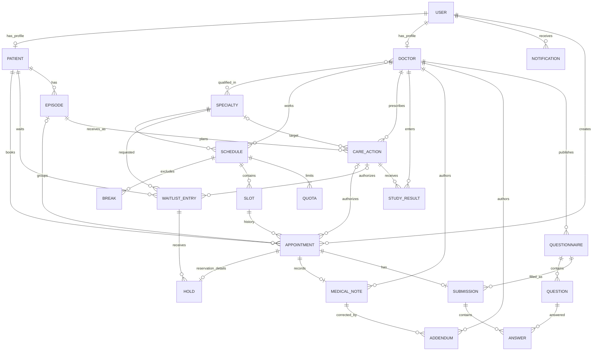

# Концептуальная ER-модель

Модель отражает поликлинику из финального отчета этапа 1. Сущности имеют независимый смысл; справочники, ассоциации и технические сущности выделены отдельно. Всего в реализации 24 таблицы, в том числе 20 основных предметных сущностей; требование не менее 10 выполнено без учета настроек и журнала.

Кардинальность `o|` означает 0..1, `||` — ровно 1, `o{` — 0..N, `|{` — 1..N.
Связь врачей и специальностей — **M:N**, реализуется ассоциативной таблицей `doctor_specialties` с составным первичным ключом.
Каждый рабочий день имеет ровно три квоты; это дополнительное ограничение поверх 1:N.
У слота может быть много записей в истории отмен, но не более одной неотмененной записи, включая резерв.
Направление является мероприятием вида `referral`, повторный приём — `followup`, исследование — `study`.
Для самостоятельной записи эпизод необязателен до завершения приёма, для направления и повтора обязателен сразу.

Основные атрибуты и ключи приведены в [даталогической модели](logical.md); исходные пользовательские диаграммы сохранены в `source_clinic.drawio` и `source_ER.drawio`.
`audit_log` и `system_settings` — технические сущности, они не участвуют в диаграмме клинических отношений. У аудитора хранится имя роли БД; персональный пользовательский аудит будет добавлен при интеграции с серверной аутентификацией.
