# Даталогическая модель PostgreSQL

Сгенерировано из установленной схемы `clinic`. Точный перечень ограничений приведен под каждой таблицей.

Дополнительные межтабличные правила и переходы состояний: `sql/02_integrity.sql`.

```mermaid
erDiagram
    appointments {
        bigint id
        bigint patient_id
        bigint slot_id
        bigint episode_id
        bigint care_action_id
        bigint created_by_user_id
        text booking_type
        text status
        timestamp_with_time_zone starts_at
        timestamp_with_time_zone ends_at
        timestamp_with_time_zone created_at
    }
    audit_log {
        bigint id
        text db_actor
        text action
        text entity_type
        bigint entity_id
        timestamp_with_time_zone created_at
    }
    care_actions {
        bigint id
        bigint episode_id
        bigint created_by_doctor_id
        bigint target_specialty_id
        text kind
        text title
        text status
    }
    daily_quotas {
        bigint schedule_id
        text booking_type
        integer slot_limit
    }
    doctor_schedules {
        bigint id
        bigint doctor_id
        bigint specialty_id
        date work_date
        time_without_time_zone start_time
        time_without_time_zone end_time
        integer slot_minutes
        timestamp_with_time_zone release_at
    }
    doctor_specialties {
        bigint doctor_id
        bigint specialty_id
    }
    doctors {
        bigint id
        bigint user_id
        text full_name
    }
    episodes {
        bigint id
        bigint patient_id
        text title
        text status
        timestamp_with_time_zone opened_at
        timestamp_with_time_zone last_activity_at
    }
    medical_notes {
        bigint id
        bigint appointment_id
        bigint author_doctor_id
        text complaints
        text examination
        text diagnosis
        text recommendations
    }
    note_addenda {
        bigint id
        bigint medical_note_id
        bigint doctor_id
        text content
        timestamp_with_time_zone created_at
    }
    notifications {
        bigint id
        bigint user_id
        text message
        boolean is_read
        timestamp_with_time_zone created_at
    }
    patients {
        bigint id
        bigint user_id
        text full_name
        date birth_date
        text oms_number
    }
    questionnaire_answers {
        bigint submission_id
        bigint question_id
        bigint questionnaire_id
        text answer_text
    }
    questionnaire_submissions {
        bigint id
        bigint appointment_id
        bigint questionnaire_id
        timestamp_with_time_zone submitted_at
    }
    questionnaires {
        bigint id
        bigint doctor_id
        integer version
        text title
        boolean is_active
    }
    questions {
        bigint id
        bigint questionnaire_id
        integer position
        text question_text
    }
    schedule_breaks {
        bigint id
        bigint schedule_id
        time_without_time_zone start_time
        time_without_time_zone end_time
    }
    slot_holds {
        bigint id
        bigint waitlist_entry_id
        bigint appointment_id
        timestamp_with_time_zone expires_at
        text status
    }
    specialties {
        bigint id
        text name
        boolean self_booking_allowed
    }
    study_results {
        bigint id
        bigint care_action_id
        bigint entered_by_doctor_id
        text result_text
        timestamp_with_time_zone performed_at
    }
    system_settings {
        boolean singleton
        integer hold_minutes
        integer inactivity_days
    }
    time_slots {
        bigint id
        bigint schedule_id
        timestamp_with_time_zone starts_at
        timestamp_with_time_zone ends_at
    }
    users {
        bigint id
        text login
        text password_hash
        text role
        boolean is_blocked
    }
    waitlist_entries {
        bigint id
        bigint patient_id
        bigint specialty_id
        bigint care_action_id
        text booking_type
        timestamp_with_time_zone preferred_from
        timestamp_with_time_zone preferred_until
        text status
        timestamp_with_time_zone created_at
    }
    users ||--o{ patients : patients_user_id_fkey
    users ||--o{ doctors : doctors_user_id_fkey
    doctors ||--o{ doctor_specialties : doctor_specialties_doctor_id_fkey
    specialties ||--o{ doctor_specialties : doctor_specialties_specialty_id_fkey
    doctor_specialties ||--o{ doctor_schedules : doctor_schedules_doctor_id_specialty_id_fkey
    doctor_schedules ||--o{ schedule_breaks : schedule_breaks_schedule_id_fkey
    doctor_schedules ||--o{ time_slots : time_slots_schedule_id_fkey
    doctor_schedules ||--o{ daily_quotas : daily_quotas_schedule_id_fkey
    patients ||--o{ episodes : episodes_patient_id_fkey
    episodes ||--o{ care_actions : care_actions_episode_id_fkey
    doctors ||--o{ care_actions : care_actions_created_by_doctor_id_fkey
    specialties ||--o{ care_actions : care_actions_target_specialty_id_fkey
    care_actions ||--o{ appointments : appointments_care_action_id_episode_id_fkey
    patients ||--o{ appointments : appointments_patient_id_fkey
    time_slots ||--o{ appointments : appointments_slot_id_fkey
    users ||--o{ appointments : appointments_created_by_user_id_fkey
    episodes ||--o{ appointments : appointments_episode_id_patient_id_fkey
    patients ||--o{ waitlist_entries : waitlist_entries_patient_id_fkey
    specialties ||--o{ waitlist_entries : waitlist_entries_specialty_id_fkey
    care_actions ||--o{ waitlist_entries : waitlist_entries_care_action_id_fkey
    waitlist_entries ||--o{ slot_holds : slot_holds_waitlist_entry_id_fkey
    appointments ||--o{ slot_holds : slot_holds_appointment_id_fkey
    users ||--o{ notifications : notifications_user_id_fkey
    appointments ||--o{ medical_notes : medical_notes_appointment_id_fkey
    doctors ||--o{ medical_notes : medical_notes_author_doctor_id_fkey
    medical_notes ||--o{ note_addenda : note_addenda_medical_note_id_fkey
    doctors ||--o{ note_addenda : note_addenda_doctor_id_fkey
    care_actions ||--o{ study_results : study_results_care_action_id_fkey
    doctors ||--o{ study_results : study_results_entered_by_doctor_id_fkey
    doctors ||--o{ questionnaires : questionnaires_doctor_id_fkey
    questionnaires ||--o{ questions : questions_questionnaire_id_fkey
    appointments ||--o{ questionnaire_submissions : questionnaire_submissions_appointment_id_fkey
    questionnaires ||--o{ questionnaire_submissions : questionnaire_submissions_questionnaire_id_fkey
    questionnaire_submissions ||--o{ questionnaire_answers : questionnaire_answers_submission_id_questionnaire_id_fkey
    questions ||--o{ questionnaire_answers : questionnaire_answers_question_id_questionnaire_id_fkey
```

Диаграмма FK показывает связи родитель–потомки; точная обязательность и уникальность определяются NULL/UNIQUE в словаре ниже. Концептуальные кардинальности — в `er.md`.

## appointments

| Поле | Тип | NULL | По умолчанию |
|---|---|---|---|
| id | bigint | NO | IDENTITY |
| patient_id | bigint | NO | — |
| slot_id | bigint | NO | — |
| episode_id | bigint | YES | — |
| care_action_id | bigint | YES | — |
| created_by_user_id | bigint | NO | — |
| booking_type | text | NO | — |
| status | text | NO | 'planned'::text |
| starts_at | timestamp with time zone | NO | — |
| ends_at | timestamp with time zone | NO | — |
| created_at | timestamp with time zone | NO | now() |

- `appointments_care_action_id_episode_id_fkey`: `FOREIGN KEY (care_action_id, episode_id) REFERENCES clinic.care_actions(id, episode_id)`
- `appointments_booking_type_check`: `CHECK ((booking_type = ANY (ARRAY['self'::text, 'referral'::text, 'followup'::text])))`
- `appointments_status_check`: `CHECK ((status = ANY (ARRAY['held'::text, 'planned'::text, 'completed'::text, 'cancelled'::text, 'no_show'::text])))`
- `appointments_check`: `CHECK ((starts_at < ends_at))`
- `appointments_check1`: `CHECK ((((booking_type = 'self'::text) AND (care_action_id IS NULL)) OR ((booking_type <> 'self'::text) AND (care_action_id IS NOT NULL) AND (episode_id IS NOT NULL))))`
- `appointments_id_not_null`: `NOT NULL id`
- `appointments_patient_id_not_null`: `NOT NULL patient_id`
- `appointments_slot_id_not_null`: `NOT NULL slot_id`
- `appointments_created_by_user_id_not_null`: `NOT NULL created_by_user_id`
- `appointments_booking_type_not_null`: `NOT NULL booking_type`
- `appointments_status_not_null`: `NOT NULL status`
- `appointments_starts_at_not_null`: `NOT NULL starts_at`
- `appointments_ends_at_not_null`: `NOT NULL ends_at`
- `appointments_created_at_not_null`: `NOT NULL created_at`
- `appointments_pkey`: `PRIMARY KEY (id)`
- `appointments_patient_id_tstzrange_excl`: `EXCLUDE USING gist (patient_id WITH =, tstzrange(starts_at, ends_at, '[)'::text) WITH &&) WHERE ((status = ANY (ARRAY['held'::text, 'planned'::text, 'completed'::text, 'no_show'::text])))`
- `appointments_patient_id_fkey`: `FOREIGN KEY (patient_id) REFERENCES clinic.patients(id)`
- `appointments_slot_id_fkey`: `FOREIGN KEY (slot_id) REFERENCES clinic.time_slots(id)`
- `appointments_created_by_user_id_fkey`: `FOREIGN KEY (created_by_user_id) REFERENCES clinic.users(id)`
- `appointments_episode_id_patient_id_fkey`: `FOREIGN KEY (episode_id, patient_id) REFERENCES clinic.episodes(id, patient_id)`
- `validate_state`: `TRIGGER DEFERRABLE INITIALLY DEFERRED`

## audit_log

| Поле | Тип | NULL | По умолчанию |
|---|---|---|---|
| id | bigint | NO | IDENTITY |
| db_actor | text | NO | SESSION_USER |
| action | text | NO | — |
| entity_type | text | NO | — |
| entity_id | bigint | YES | — |
| created_at | timestamp with time zone | NO | now() |

- `audit_log_id_not_null`: `NOT NULL id`
- `audit_log_db_actor_not_null`: `NOT NULL db_actor`
- `audit_log_action_not_null`: `NOT NULL action`
- `audit_log_entity_type_not_null`: `NOT NULL entity_type`
- `audit_log_created_at_not_null`: `NOT NULL created_at`
- `audit_log_pkey`: `PRIMARY KEY (id)`

## care_actions

| Поле | Тип | NULL | По умолчанию |
|---|---|---|---|
| id | bigint | NO | IDENTITY |
| episode_id | bigint | NO | — |
| created_by_doctor_id | bigint | NO | — |
| target_specialty_id | bigint | YES | — |
| kind | text | NO | — |
| title | text | NO | — |
| status | text | NO | 'assigned'::text |

- `care_actions_kind_check`: `CHECK ((kind = ANY (ARRAY['referral'::text, 'followup'::text, 'study'::text])))`
- `care_actions_status_check`: `CHECK ((status = ANY (ARRAY['assigned'::text, 'booked'::text, 'completed'::text, 'cancelled'::text])))`
- `care_actions_check`: `CHECK (((kind = 'study'::text) OR (target_specialty_id IS NOT NULL)))`
- `care_actions_id_not_null`: `NOT NULL id`
- `care_actions_episode_id_not_null`: `NOT NULL episode_id`
- `care_actions_created_by_doctor_id_not_null`: `NOT NULL created_by_doctor_id`
- `care_actions_kind_not_null`: `NOT NULL kind`
- `care_actions_title_not_null`: `NOT NULL title`
- `care_actions_status_not_null`: `NOT NULL status`
- `care_actions_pkey`: `PRIMARY KEY (id)`
- `care_actions_id_episode_id_key`: `UNIQUE (id, episode_id)`
- `care_actions_episode_id_fkey`: `FOREIGN KEY (episode_id) REFERENCES clinic.episodes(id)`
- `care_actions_created_by_doctor_id_fkey`: `FOREIGN KEY (created_by_doctor_id) REFERENCES clinic.doctors(id)`
- `care_actions_target_specialty_id_fkey`: `FOREIGN KEY (target_specialty_id) REFERENCES clinic.specialties(id)`
- `validate_state`: `TRIGGER DEFERRABLE INITIALLY DEFERRED`

## daily_quotas

| Поле | Тип | NULL | По умолчанию |
|---|---|---|---|
| schedule_id | bigint | NO | — |
| booking_type | text | NO | — |
| slot_limit | integer | NO | — |

- `daily_quotas_booking_type_check`: `CHECK ((booking_type = ANY (ARRAY['self'::text, 'referral'::text, 'followup'::text])))`
- `daily_quotas_slot_limit_check`: `CHECK ((slot_limit >= 0))`
- `daily_quotas_slot_limit_not_null`: `NOT NULL slot_limit`
- `daily_quotas_schedule_id_not_null`: `NOT NULL schedule_id`
- `daily_quotas_booking_type_not_null`: `NOT NULL booking_type`
- `daily_quotas_pkey`: `PRIMARY KEY (schedule_id, booking_type)`
- `daily_quotas_schedule_id_fkey`: `FOREIGN KEY (schedule_id) REFERENCES clinic.doctor_schedules(id)`
- `validate_state`: `TRIGGER DEFERRABLE INITIALLY DEFERRED`

## doctor_schedules

| Поле | Тип | NULL | По умолчанию |
|---|---|---|---|
| id | bigint | NO | IDENTITY |
| doctor_id | bigint | NO | — |
| specialty_id | bigint | NO | — |
| work_date | date | NO | — |
| start_time | time without time zone | NO | — |
| end_time | time without time zone | NO | — |
| slot_minutes | integer | NO | — |
| release_at | timestamp with time zone | NO | — |

- `doctor_schedules_slot_minutes_check`: `CHECK (((slot_minutes >= 5) AND (slot_minutes <= 240)))`
- `doctor_schedules_check`: `CHECK ((start_time < end_time))`
- `doctor_schedules_id_not_null`: `NOT NULL id`
- `doctor_schedules_doctor_id_not_null`: `NOT NULL doctor_id`
- `doctor_schedules_specialty_id_not_null`: `NOT NULL specialty_id`
- `doctor_schedules_work_date_not_null`: `NOT NULL work_date`
- `doctor_schedules_start_time_not_null`: `NOT NULL start_time`
- `doctor_schedules_end_time_not_null`: `NOT NULL end_time`
- `doctor_schedules_slot_minutes_not_null`: `NOT NULL slot_minutes`
- `doctor_schedules_release_at_not_null`: `NOT NULL release_at`
- `doctor_schedules_pkey`: `PRIMARY KEY (id)`
- `doctor_schedules_doctor_id_work_date_key`: `UNIQUE (doctor_id, work_date)`
- `doctor_schedules_doctor_id_specialty_id_fkey`: `FOREIGN KEY (doctor_id, specialty_id) REFERENCES clinic.doctor_specialties(doctor_id, specialty_id)`
- `validate_state`: `TRIGGER DEFERRABLE INITIALLY DEFERRED`

## doctor_specialties

| Поле | Тип | NULL | По умолчанию |
|---|---|---|---|
| doctor_id | bigint | NO | — |
| specialty_id | bigint | NO | — |

- `doctor_specialties_doctor_id_not_null`: `NOT NULL doctor_id`
- `doctor_specialties_specialty_id_not_null`: `NOT NULL specialty_id`
- `doctor_specialties_pkey`: `PRIMARY KEY (doctor_id, specialty_id)`
- `doctor_specialties_doctor_id_fkey`: `FOREIGN KEY (doctor_id) REFERENCES clinic.doctors(id)`
- `doctor_specialties_specialty_id_fkey`: `FOREIGN KEY (specialty_id) REFERENCES clinic.specialties(id)`
- `validate_state`: `TRIGGER DEFERRABLE INITIALLY DEFERRED`

## doctors

| Поле | Тип | NULL | По умолчанию |
|---|---|---|---|
| id | bigint | NO | IDENTITY |
| user_id | bigint | NO | — |
| full_name | text | NO | — |

- `doctors_full_name_check`: `CHECK ((TRIM(BOTH FROM full_name) <> ''::text))`
- `doctors_id_not_null`: `NOT NULL id`
- `doctors_user_id_not_null`: `NOT NULL user_id`
- `doctors_full_name_not_null`: `NOT NULL full_name`
- `doctors_pkey`: `PRIMARY KEY (id)`
- `doctors_user_id_key`: `UNIQUE (user_id)`
- `doctors_user_id_fkey`: `FOREIGN KEY (user_id) REFERENCES clinic.users(id)`
- `validate_state`: `TRIGGER DEFERRABLE INITIALLY DEFERRED`

## episodes

| Поле | Тип | NULL | По умолчанию |
|---|---|---|---|
| id | bigint | NO | IDENTITY |
| patient_id | bigint | NO | — |
| title | text | NO | — |
| status | text | NO | 'active'::text |
| opened_at | timestamp with time zone | NO | now() |
| last_activity_at | timestamp with time zone | NO | now() |

- `episodes_status_check`: `CHECK ((status = ANY (ARRAY['active'::text, 'closed'::text])))`
- `episodes_id_not_null`: `NOT NULL id`
- `episodes_patient_id_not_null`: `NOT NULL patient_id`
- `episodes_title_not_null`: `NOT NULL title`
- `episodes_status_not_null`: `NOT NULL status`
- `episodes_opened_at_not_null`: `NOT NULL opened_at`
- `episodes_last_activity_at_not_null`: `NOT NULL last_activity_at`
- `episodes_pkey`: `PRIMARY KEY (id)`
- `episodes_id_patient_id_key`: `UNIQUE (id, patient_id)`
- `episodes_patient_id_fkey`: `FOREIGN KEY (patient_id) REFERENCES clinic.patients(id)`
- `validate_state`: `TRIGGER DEFERRABLE INITIALLY DEFERRED`

## medical_notes

| Поле | Тип | NULL | По умолчанию |
|---|---|---|---|
| id | bigint | NO | IDENTITY |
| appointment_id | bigint | NO | — |
| author_doctor_id | bigint | NO | — |
| complaints | text | NO | — |
| examination | text | NO | — |
| diagnosis | text | NO | — |
| recommendations | text | NO | — |

- `medical_notes_id_not_null`: `NOT NULL id`
- `medical_notes_appointment_id_not_null`: `NOT NULL appointment_id`
- `medical_notes_author_doctor_id_not_null`: `NOT NULL author_doctor_id`
- `medical_notes_complaints_not_null`: `NOT NULL complaints`
- `medical_notes_examination_not_null`: `NOT NULL examination`
- `medical_notes_diagnosis_not_null`: `NOT NULL diagnosis`
- `medical_notes_recommendations_not_null`: `NOT NULL recommendations`
- `medical_notes_pkey`: `PRIMARY KEY (id)`
- `medical_notes_appointment_id_key`: `UNIQUE (appointment_id)`
- `medical_notes_appointment_id_fkey`: `FOREIGN KEY (appointment_id) REFERENCES clinic.appointments(id)`
- `medical_notes_author_doctor_id_fkey`: `FOREIGN KEY (author_doctor_id) REFERENCES clinic.doctors(id)`
- `validate_state`: `TRIGGER DEFERRABLE INITIALLY DEFERRED`

## note_addenda

| Поле | Тип | NULL | По умолчанию |
|---|---|---|---|
| id | bigint | NO | IDENTITY |
| medical_note_id | bigint | NO | — |
| doctor_id | bigint | NO | — |
| content | text | NO | — |
| created_at | timestamp with time zone | NO | now() |

- `note_addenda_content_check`: `CHECK ((TRIM(BOTH FROM content) <> ''::text))`
- `note_addenda_id_not_null`: `NOT NULL id`
- `note_addenda_medical_note_id_not_null`: `NOT NULL medical_note_id`
- `note_addenda_doctor_id_not_null`: `NOT NULL doctor_id`
- `note_addenda_content_not_null`: `NOT NULL content`
- `note_addenda_created_at_not_null`: `NOT NULL created_at`
- `note_addenda_pkey`: `PRIMARY KEY (id)`
- `note_addenda_medical_note_id_fkey`: `FOREIGN KEY (medical_note_id) REFERENCES clinic.medical_notes(id)`
- `note_addenda_doctor_id_fkey`: `FOREIGN KEY (doctor_id) REFERENCES clinic.doctors(id)`
- `validate_state`: `TRIGGER DEFERRABLE INITIALLY DEFERRED`

## notifications

| Поле | Тип | NULL | По умолчанию |
|---|---|---|---|
| id | bigint | NO | IDENTITY |
| user_id | bigint | NO | — |
| message | text | NO | — |
| is_read | boolean | NO | false |
| created_at | timestamp with time zone | NO | now() |

- `notifications_id_not_null`: `NOT NULL id`
- `notifications_user_id_not_null`: `NOT NULL user_id`
- `notifications_message_not_null`: `NOT NULL message`
- `notifications_is_read_not_null`: `NOT NULL is_read`
- `notifications_created_at_not_null`: `NOT NULL created_at`
- `notifications_pkey`: `PRIMARY KEY (id)`
- `notifications_user_id_fkey`: `FOREIGN KEY (user_id) REFERENCES clinic.users(id)`

## patients

| Поле | Тип | NULL | По умолчанию |
|---|---|---|---|
| id | bigint | NO | IDENTITY |
| user_id | bigint | NO | — |
| full_name | text | NO | — |
| birth_date | date | NO | — |
| oms_number | text | NO | — |

- `patients_full_name_check`: `CHECK ((TRIM(BOTH FROM full_name) <> ''::text))`
- `patients_oms_number_check`: `CHECK ((oms_number ~ '^[0-9]{16}$'::text))`
- `patients_id_not_null`: `NOT NULL id`
- `patients_user_id_not_null`: `NOT NULL user_id`
- `patients_full_name_not_null`: `NOT NULL full_name`
- `patients_birth_date_not_null`: `NOT NULL birth_date`
- `patients_oms_number_not_null`: `NOT NULL oms_number`
- `patients_pkey`: `PRIMARY KEY (id)`
- `patients_user_id_key`: `UNIQUE (user_id)`
- `patients_oms_number_key`: `UNIQUE (oms_number)`
- `patients_user_id_fkey`: `FOREIGN KEY (user_id) REFERENCES clinic.users(id)`
- `validate_state`: `TRIGGER DEFERRABLE INITIALLY DEFERRED`

## questionnaire_answers

| Поле | Тип | NULL | По умолчанию |
|---|---|---|---|
| submission_id | bigint | NO | — |
| question_id | bigint | NO | — |
| questionnaire_id | bigint | NO | — |
| answer_text | text | NO | — |

- `questionnaire_answers_submission_id_not_null`: `NOT NULL submission_id`
- `questionnaire_answers_question_id_not_null`: `NOT NULL question_id`
- `questionnaire_answers_questionnaire_id_not_null`: `NOT NULL questionnaire_id`
- `questionnaire_answers_answer_text_not_null`: `NOT NULL answer_text`
- `questionnaire_answers_pkey`: `PRIMARY KEY (submission_id, question_id)`
- `questionnaire_answers_submission_id_questionnaire_id_fkey`: `FOREIGN KEY (submission_id, questionnaire_id) REFERENCES clinic.questionnaire_submissions(id, questionnaire_id)`
- `questionnaire_answers_question_id_questionnaire_id_fkey`: `FOREIGN KEY (question_id, questionnaire_id) REFERENCES clinic.questions(id, questionnaire_id)`
- `validate_state`: `TRIGGER DEFERRABLE INITIALLY DEFERRED`

## questionnaire_submissions

| Поле | Тип | NULL | По умолчанию |
|---|---|---|---|
| id | bigint | NO | IDENTITY |
| appointment_id | bigint | NO | — |
| questionnaire_id | bigint | NO | — |
| submitted_at | timestamp with time zone | NO | now() |

- `questionnaire_submissions_id_not_null`: `NOT NULL id`
- `questionnaire_submissions_appointment_id_not_null`: `NOT NULL appointment_id`
- `questionnaire_submissions_questionnaire_id_not_null`: `NOT NULL questionnaire_id`
- `questionnaire_submissions_submitted_at_not_null`: `NOT NULL submitted_at`
- `questionnaire_submissions_pkey`: `PRIMARY KEY (id)`
- `questionnaire_submissions_appointment_id_key`: `UNIQUE (appointment_id)`
- `questionnaire_submissions_id_questionnaire_id_key`: `UNIQUE (id, questionnaire_id)`
- `questionnaire_submissions_appointment_id_fkey`: `FOREIGN KEY (appointment_id) REFERENCES clinic.appointments(id)`
- `questionnaire_submissions_questionnaire_id_fkey`: `FOREIGN KEY (questionnaire_id) REFERENCES clinic.questionnaires(id)`
- `validate_state`: `TRIGGER DEFERRABLE INITIALLY DEFERRED`

## questionnaires

| Поле | Тип | NULL | По умолчанию |
|---|---|---|---|
| id | bigint | NO | IDENTITY |
| doctor_id | bigint | NO | — |
| version | integer | NO | — |
| title | text | NO | — |
| is_active | boolean | NO | true |

- `questionnaires_version_check`: `CHECK ((version > 0))`
- `questionnaires_id_not_null`: `NOT NULL id`
- `questionnaires_doctor_id_not_null`: `NOT NULL doctor_id`
- `questionnaires_version_not_null`: `NOT NULL version`
- `questionnaires_title_not_null`: `NOT NULL title`
- `questionnaires_is_active_not_null`: `NOT NULL is_active`
- `questionnaires_pkey`: `PRIMARY KEY (id)`
- `questionnaires_doctor_id_version_key`: `UNIQUE (doctor_id, version)`
- `questionnaires_doctor_id_fkey`: `FOREIGN KEY (doctor_id) REFERENCES clinic.doctors(id)`
- `validate_state`: `TRIGGER DEFERRABLE INITIALLY DEFERRED`

## questions

| Поле | Тип | NULL | По умолчанию |
|---|---|---|---|
| id | bigint | NO | IDENTITY |
| questionnaire_id | bigint | NO | — |
| position | integer | NO | — |
| question_text | text | NO | — |

- `questions_position_check`: `CHECK (("position" > 0))`
- `questions_id_not_null`: `NOT NULL id`
- `questions_questionnaire_id_not_null`: `NOT NULL questionnaire_id`
- `questions_position_not_null`: `NOT NULL "position"`
- `questions_question_text_not_null`: `NOT NULL question_text`
- `questions_pkey`: `PRIMARY KEY (id)`
- `questions_questionnaire_id_position_key`: `UNIQUE (questionnaire_id, "position")`
- `questions_id_questionnaire_id_key`: `UNIQUE (id, questionnaire_id)`
- `questions_questionnaire_id_fkey`: `FOREIGN KEY (questionnaire_id) REFERENCES clinic.questionnaires(id)`
- `validate_state`: `TRIGGER DEFERRABLE INITIALLY DEFERRED`

## schedule_breaks

| Поле | Тип | NULL | По умолчанию |
|---|---|---|---|
| id | bigint | NO | IDENTITY |
| schedule_id | bigint | NO | — |
| start_time | time without time zone | NO | — |
| end_time | time without time zone | NO | — |

- `schedule_breaks_check`: `CHECK ((start_time < end_time))`
- `schedule_breaks_id_not_null`: `NOT NULL id`
- `schedule_breaks_schedule_id_not_null`: `NOT NULL schedule_id`
- `schedule_breaks_start_time_not_null`: `NOT NULL start_time`
- `schedule_breaks_end_time_not_null`: `NOT NULL end_time`
- `schedule_breaks_pkey`: `PRIMARY KEY (id)`
- `schedule_breaks_schedule_id_fkey`: `FOREIGN KEY (schedule_id) REFERENCES clinic.doctor_schedules(id)`
- `validate_state`: `TRIGGER DEFERRABLE INITIALLY DEFERRED`

## slot_holds

| Поле | Тип | NULL | По умолчанию |
|---|---|---|---|
| id | bigint | NO | IDENTITY |
| waitlist_entry_id | bigint | NO | — |
| appointment_id | bigint | NO | — |
| expires_at | timestamp with time zone | NO | — |
| status | text | NO | 'active'::text |

- `slot_holds_appointment_id_not_null`: `NOT NULL appointment_id`
- `slot_holds_expires_at_not_null`: `NOT NULL expires_at`
- `slot_holds_status_not_null`: `NOT NULL status`
- `slot_holds_pkey`: `PRIMARY KEY (id)`
- `slot_holds_status_check`: `CHECK ((status = ANY (ARRAY['active'::text, 'confirmed'::text, 'declined'::text, 'expired'::text])))`
- `slot_holds_id_not_null`: `NOT NULL id`
- `slot_holds_waitlist_entry_id_not_null`: `NOT NULL waitlist_entry_id`
- `slot_holds_appointment_id_key`: `UNIQUE (appointment_id)`
- `slot_holds_waitlist_entry_id_fkey`: `FOREIGN KEY (waitlist_entry_id) REFERENCES clinic.waitlist_entries(id)`
- `slot_holds_appointment_id_fkey`: `FOREIGN KEY (appointment_id) REFERENCES clinic.appointments(id)`
- `validate_state`: `TRIGGER DEFERRABLE INITIALLY DEFERRED`

## specialties

| Поле | Тип | NULL | По умолчанию |
|---|---|---|---|
| id | bigint | NO | IDENTITY |
| name | text | NO | — |
| self_booking_allowed | boolean | NO | false |

- `specialties_id_not_null`: `NOT NULL id`
- `specialties_name_not_null`: `NOT NULL name`
- `specialties_self_booking_allowed_not_null`: `NOT NULL self_booking_allowed`
- `specialties_pkey`: `PRIMARY KEY (id)`
- `specialties_name_key`: `UNIQUE (name)`
- `validate_state`: `TRIGGER DEFERRABLE INITIALLY DEFERRED`

## study_results

| Поле | Тип | NULL | По умолчанию |
|---|---|---|---|
| id | bigint | NO | IDENTITY |
| care_action_id | bigint | NO | — |
| entered_by_doctor_id | bigint | NO | — |
| result_text | text | NO | — |
| performed_at | timestamp with time zone | NO | now() |

- `study_results_id_not_null`: `NOT NULL id`
- `study_results_care_action_id_not_null`: `NOT NULL care_action_id`
- `study_results_entered_by_doctor_id_not_null`: `NOT NULL entered_by_doctor_id`
- `study_results_result_text_not_null`: `NOT NULL result_text`
- `study_results_performed_at_not_null`: `NOT NULL performed_at`
- `study_results_pkey`: `PRIMARY KEY (id)`
- `study_results_care_action_id_fkey`: `FOREIGN KEY (care_action_id) REFERENCES clinic.care_actions(id)`
- `study_results_entered_by_doctor_id_fkey`: `FOREIGN KEY (entered_by_doctor_id) REFERENCES clinic.doctors(id)`
- `validate_state`: `TRIGGER DEFERRABLE INITIALLY DEFERRED`

## system_settings

| Поле | Тип | NULL | По умолчанию |
|---|---|---|---|
| singleton | boolean | NO | true |
| hold_minutes | integer | NO | 30 |
| inactivity_days | integer | NO | 60 |

- `system_settings_singleton_check`: `CHECK (singleton)`
- `system_settings_hold_minutes_check`: `CHECK (((hold_minutes >= 1) AND (hold_minutes <= 1440)))`
- `system_settings_inactivity_days_check`: `CHECK ((inactivity_days > 0))`
- `system_settings_singleton_not_null`: `NOT NULL singleton`
- `system_settings_hold_minutes_not_null`: `NOT NULL hold_minutes`
- `system_settings_inactivity_days_not_null`: `NOT NULL inactivity_days`
- `system_settings_pkey`: `PRIMARY KEY (singleton)`

## time_slots

| Поле | Тип | NULL | По умолчанию |
|---|---|---|---|
| id | bigint | NO | IDENTITY |
| schedule_id | bigint | NO | — |
| starts_at | timestamp with time zone | NO | — |
| ends_at | timestamp with time zone | NO | — |

- `time_slots_check`: `CHECK ((starts_at < ends_at))`
- `time_slots_id_not_null`: `NOT NULL id`
- `time_slots_schedule_id_not_null`: `NOT NULL schedule_id`
- `time_slots_starts_at_not_null`: `NOT NULL starts_at`
- `time_slots_ends_at_not_null`: `NOT NULL ends_at`
- `time_slots_pkey`: `PRIMARY KEY (id)`
- `time_slots_schedule_id_tstzrange_excl`: `EXCLUDE USING gist (schedule_id WITH =, tstzrange(starts_at, ends_at, '[)'::text) WITH &&)`
- `time_slots_schedule_id_fkey`: `FOREIGN KEY (schedule_id) REFERENCES clinic.doctor_schedules(id)`
- `validate_state`: `TRIGGER DEFERRABLE INITIALLY DEFERRED`

## users

| Поле | Тип | NULL | По умолчанию |
|---|---|---|---|
| id | bigint | NO | IDENTITY |
| login | text | NO | — |
| password_hash | text | NO | — |
| role | text | NO | — |
| is_blocked | boolean | NO | false |

- `users_login_check`: `CHECK ((length(TRIM(BOTH FROM login)) >= 3))`
- `users_password_hash_check`: `CHECK ((length(password_hash) >= 20))`
- `users_role_check`: `CHECK ((role = ANY (ARRAY['patient'::text, 'doctor'::text, 'registrar'::text, 'admin'::text])))`
- `users_id_not_null`: `NOT NULL id`
- `users_login_not_null`: `NOT NULL login`
- `users_password_hash_not_null`: `NOT NULL password_hash`
- `users_role_not_null`: `NOT NULL role`
- `users_is_blocked_not_null`: `NOT NULL is_blocked`
- `users_pkey`: `PRIMARY KEY (id)`
- `users_login_key`: `UNIQUE (login)`
- `validate_state`: `TRIGGER DEFERRABLE INITIALLY DEFERRED`

## waitlist_entries

| Поле | Тип | NULL | По умолчанию |
|---|---|---|---|
| id | bigint | NO | IDENTITY |
| patient_id | bigint | NO | — |
| specialty_id | bigint | NO | — |
| care_action_id | bigint | YES | — |
| booking_type | text | NO | — |
| preferred_from | timestamp with time zone | NO | — |
| preferred_until | timestamp with time zone | NO | — |
| status | text | NO | 'waiting'::text |
| created_at | timestamp with time zone | NO | now() |

- `waitlist_entries_booking_type_check`: `CHECK ((booking_type = ANY (ARRAY['self'::text, 'referral'::text, 'followup'::text])))`
- `waitlist_entries_status_check`: `CHECK ((status = ANY (ARRAY['waiting'::text, 'offered'::text, 'accepted'::text, 'cancelled'::text, 'expired'::text])))`
- `waitlist_entries_check`: `CHECK ((preferred_from < preferred_until))`
- `waitlist_entries_check1`: `CHECK (((booking_type = 'self'::text) = (care_action_id IS NULL)))`
- `waitlist_entries_id_not_null`: `NOT NULL id`
- `waitlist_entries_patient_id_not_null`: `NOT NULL patient_id`
- `waitlist_entries_specialty_id_not_null`: `NOT NULL specialty_id`
- `waitlist_entries_booking_type_not_null`: `NOT NULL booking_type`
- `waitlist_entries_preferred_from_not_null`: `NOT NULL preferred_from`
- `waitlist_entries_preferred_until_not_null`: `NOT NULL preferred_until`
- `waitlist_entries_status_not_null`: `NOT NULL status`
- `waitlist_entries_created_at_not_null`: `NOT NULL created_at`
- `waitlist_entries_pkey`: `PRIMARY KEY (id)`
- `waitlist_entries_patient_id_fkey`: `FOREIGN KEY (patient_id) REFERENCES clinic.patients(id)`
- `waitlist_entries_specialty_id_fkey`: `FOREIGN KEY (specialty_id) REFERENCES clinic.specialties(id)`
- `waitlist_entries_care_action_id_fkey`: `FOREIGN KEY (care_action_id) REFERENCES clinic.care_actions(id)`
- `validate_state`: `TRIGGER DEFERRABLE INITIALLY DEFERRED`

